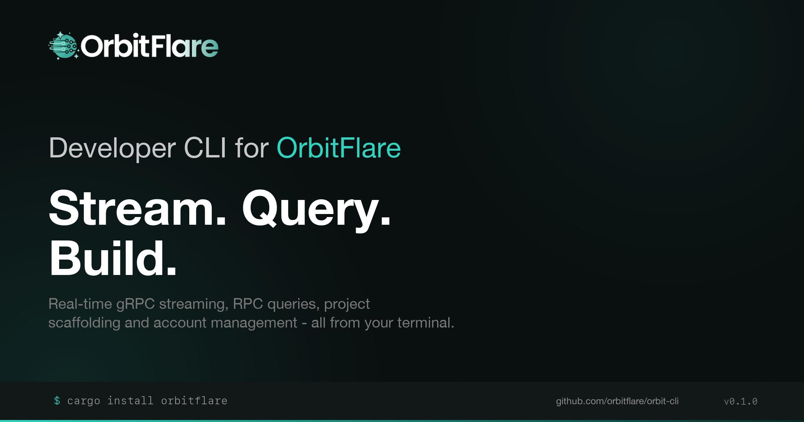

<p align="center">
  
</p>

Real-time gRPC streaming, RPC queries, project scaffolding and account management.

## Install

```bash
cargo install orbitflare
```

Or from source:

```bash
git clone https://github.com/orbitflare/orbit-cli.git
cd orbit-cli
cargo install --path .
```

Requires Rust 1.83+.

## Quick Start

```bash
# Authenticate
orbitflare auth login --x-orbit-key <YOUR_KEY>

# Set your RPC license key
orbitflare auth set-license-key <LICENSE_KEY>

# Check connectivity
orbitflare ping

# Query the blockchain
orbitflare rpc slot
orbitflare rpc balance <ADDRESS>

# Stream via Jetstream
orbitflare jet --config stream.yml

# Stream via Yellowstone gRPC
orbitflare grpc --config grpc-stream.yml

# Scaffold a project from a template
orbitflare template --list
orbitflare template --install solana-copy-trader

# Launch the TUI dashboard
orbitflare dashboard
```

## Authentication

Three login methods:

```bash
# API key (from orbitflare.com/dashboard)
orbitflare auth login --x-orbit-key <KEY>

# Solana wallet keypair
orbitflare auth login --wallet ~/.config/solana/id.json

# Device flow (browser-based)
orbitflare auth login
```

The API key (`X-ORBIT-KEY`) authenticates against the OrbitFlare Customer API. The license key authenticates RPC endpoints and is fetched automatically during login, or set manually. gRPC and Jetstream use IP whitelisting.

```bash
orbitflare auth set-license-key <KEY>
```

Credentials are stored in the OS keychain. Check status with:

```bash
orbitflare auth status
```

## Commands

### Core (always available)

| Command | Description |
|---------|-------------|
| `auth login` | Authenticate (API key, wallet, or device flow) |
| `auth logout` | Remove stored credentials |
| `auth status` | Show authentication status |
| `auth switch --profile <NAME>` | Switch auth profile |
| `auth set-license-key <KEY>` | Set RPC license key |
| `config show` | Show configuration |
| `config set <KEY> <VALUE>` | Set a config value |
| `config remove <KEY> <VALUE>` | Remove a value from a list config |
| `config reset` | Reset to defaults |
| `ping` | Check service connectivity |
| `ping --service <SVC>` | Ping a specific service (rpc, jetstream, grpc) |
| `docs [TOPIC...]` | Open docs in browser |

### Streaming & Queries

**jet** -- Real-time Jetstream gRPC streaming

```bash
orbitflare jet --config stream.yml
```

**grpc** -- Real-time Yellowstone gRPC (Geyser) streaming

```bash
orbitflare grpc --config grpc-stream.yml
```

Yellowstone adds commitment level control, vote/failed tx filtering, slot updates, block metadata, and transaction fees over Jetstream. See `examples/jet-stream.yml` and `examples/grpc-stream.yml` for full config references.

**rpc** -- Solana RPC queries

```bash
orbitflare rpc account <ADDRESS>
orbitflare rpc tokens <WALLET>
orbitflare rpc balance <ADDRESS>
orbitflare rpc tx <SIGNATURE>
orbitflare rpc history <WALLET> --limit 20
orbitflare rpc slot
orbitflare rpc epoch
orbitflare rpc blockhash
orbitflare rpc stats
orbitflare rpc priority-fees --account <ADDR>
orbitflare rpc raw <METHOD> [ARGS...] --params <JSON>
```

**template** -- Project scaffolding

```bash
orbitflare template --list
orbitflare template --list --filter rust
orbitflare template --view solana-copy-trader
orbitflare template --install solana-copy-trader --dir ./my-bot
```

Templates are fetched from the configured repo (default: `github.com/orbitflare/templates`).

**dashboard** -- TUI dashboard for account management

```bash
orbitflare dashboard
```

Sections: Home, Services, Invoices, API Keys, Profile. Full keyboard navigation.

| Key | Action |
|-----|--------|
| `q` | Quit |
| `Esc` | Back |
| `Tab` | Switch tab / focus |
| `↑↓` / `jk` | Navigate |
| `Enter` | Select / expand / toggle |
| `t` / `T` | Cycle theme |
| `[` | Toggle sidebar |
| `R` | Refresh data |

Service detail keybinds:

| Key | Tab | Action |
|-----|-----|--------|
| `m` | Details | Toggle auth mode (IP Whitelist / API Key) |
| `w` | Details | Toggle auto-renewal |
| `r` | Details | Regenerate license key |
| `n` | IPs / Domains | Switch Mainnet / Devnet |
| `a` | IPs / Domains | Add IP or domain |
| `d` | IPs / Domains | Remove IP or domain |

API Keys keybinds:

| Key | Action |
|-----|--------|
| `c` | Create new API key |
| `e` | Toggle enabled/disabled |
| `r` | Regenerate key |
| `x` | Delete key |
| `a` | Add IP (when expanded) |
| `d` | Remove IP (when expanded) |

Invoices keybinds:

| Key | Action |
|-----|--------|
| `p` | Pay with balance (pending invoices) |

Profile keybinds:

| Key | Action |
|-----|--------|
| `e` | Edit name and payment wallet |

## Configuration

Config file: `~/.orbitflare/config.yml`

```bash
orbitflare config show
orbitflare config set network devnet
orbitflare config set rpc.url http://your-rpc-endpoint
orbitflare config set grpc.url http://your-grpc-endpoint:10000
orbitflare config set jetstream.url http://your-jetstream-endpoint
orbitflare config set templates.repo https://github.com/your-org/templates
```

Devnet endpoints are hardcoded by default:
- RPC: `http://devnet.rpc.orbitflare.com` (fallback: `https://api.devnet.solana.com`)
- gRPC: `http://devnet.rpc.orbitflare.com:10000`

Use `--network devnet` to switch at runtime.

## Global Flags

```
--json              Output raw JSON
--raw               Minimal output
--network <NET>     Override network (mainnet|devnet|testnet)
--commitment <C>    Override commitment (processed|confirmed|finalized)
--rpc-url <URL>     Override RPC endpoint
--grpc-url <URL>    Override gRPC endpoint
--fallback-url <U>  Fallback URLs (repeatable)
--profile <NAME>    Use a specific auth profile
--quiet             Suppress non-essential output
--no-color          Disable colors
```
